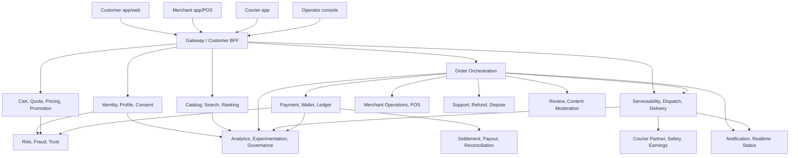

# AekioriEats -> 쿠팡이츠급 서비스 갭 분석

> 조사 기준일: 2026-08-31 (KST)
>
> 조사 대상: `main`, `HEAD 55dd1c39874fbdb2272afae3d91a754ac9467c0b` + 조사 시점 working tree
>
> 목적: 현재 구현과, 대규모 상용 배달 플랫폼이 갖춰야 할 제품·도메인·운영 계약 사이의 차이를 식별한다.

## 0. 결론

AekioriEats에는 Auth, User, Store, Order, Payment, Point, Gateway와 Outbox/Kafka/Debezium 기반의 좋은 학습용 골격이 있다. 그러나 현재 상태는 **쿠팡이츠급 서비스가 아니라, 주문 생성부터 결제·매장 수락까지 일부 흐름을 연결한 MVP/기술 데모**에 가깝다.

부족한 것은 화면 몇 개가 아니다. 고객, 사장님, 배달파트너를 실제로 연결하는 세 면의 마켓플레이스와 다음 네 종류의 진실 원천이 아직 닫히지 않았다.

1. **무엇을 얼마에 팔았는가** — 서버 권위 quote, 메뉴·옵션·할인·배달비 스냅샷
2. **누가 어떤 상태를 바꿀 수 있는가** — actor별 주문 명령과 상태 전이 소유권
3. **돈이 실제로 어디에서 어디로 이동했는가** — 결제, 포인트, 환불, 정산, 대사 원장
4. **누가 언제 어떻게 배달을 완료했는가** — 서비스권역, 배차, 이동, 증빙, 예외 처리

현재 가장 가까운 편집 지점인 UI나 검색을 먼저 고도화하면 안 된다. 가격·결제·상태·배달의 계약을 먼저 고치지 않으면, 기능이 많아져도 실거래 안전성과 배달 품질은 개선되지 않는다.

### 현재 판정

| 축 | 판정 | 이유 |
|---|---|---|
| 학습용 분산시스템 기반 | 유의미한 기반 있음 | 서비스 경계, Outbox, CDC, Kafka, Redis 멱등성, DLQ, 기초 모니터링이 존재한다. |
| 고객 주문 MVP | 부분 구현 | 탐색·카트·주문·결제 화면은 있으나 주소, 가격 권위, 실제 ETA/리뷰, 배달 완료 흐름이 없다. |
| 실결제 안전성 | **NO-GO** | 결제 검증 기본값이 꺼져 있고, 고객이 가격과 `PAID` 전이를 만들 수 있다. |
| 배달 서비스 | **미구현** | 라이더, 배차, 경로, 픽업, 배달중, 완료, 위치 추적 도메인이 없다. |
| 상용 운영 | **NO-GO** | 정산·대사·CS·분쟁·개인정보 수명주기·백업/DR·SLO/알림·운영자 통제가 닫히지 않았다. |
| 쿠팡이츠급 | **아직 아님** | 제품 표면, 거래 무결성, 배달 수행, 운영 규모를 모두 충족해야 한다. |

## 1. 범위와 주장 한계

### 이 문서에서 말하는 “쿠팡이츠급”

이 문서의 비교 기준은 쿠팡의 비공개 내부 아키텍처가 아니다. 다음 두 가지를 합친 **동급의 서비스 계약**이다.

- 공개적으로 확인 가능한 고객·사장님·배달파트너 경험
- 실결제와 실시간 배달을 다루는 대규모 상용 플랫폼의 일반적인 안전·운영 기준

따라서 이 문서는 기능 이름을 복제하는 목록이 아니라, AekioriEats가 실제 돈을 받고 배달을 약속할 수 있으려면 필요한 도메인 책임과 검증 기준을 정리한다.

### 증거 분류

- **직접 관찰**: 현재 checkout의 소스, 마이그레이션, 설정, 테스트, 문서에서 확인한 사실
- **프로젝트 주장**: README/설계 문서가 구현됐다고 설명한 내용. 소스·테스트와 별도로 취급한다.
- **외부 공개 주장**: 쿠팡 또는 앱스토어에 게시된 기능 설명. 모든 지역·계정에서 실제 동작한다는 독립 검증은 아니다.
- **해석/권고**: 위 증거로부터 AekioriEats에 필요한 계약을 도출한 것
- **미확인**: 저장소 밖의 운영 절차, 비공개 SaaS, 실제 배포 설정, 실데이터, 쿠팡 내부 구현

### 조사 당시 working tree

Gateway rate limit·trace ID 관련 파일과 `docs/README.md`에 기존 staged/unstaged 변경이 있었다. 이 문서는 그 변경을 현재 관찰 상태로 포함하되, 해당 변경을 커밋 완료나 운영 적용으로 간주하지 않는다. 기존 변경 파일은 수정하지 않았다.

## 2. 공개 제품 표면으로 본 기준선

2026-08-31에 로그인 없이 확인한 공개 자료 기준이다.

| 참여자/축 | 공개적으로 확인되는 표면 | AekioriEats에 주는 의미 |
|---|---|---|
| 고객 | 음식 및 장보기·쇼핑, 회원 혜택/할인, 결제 적립, 포장·픽업, 실시간 배달 경로, 위치·알림·사진 사용 | 음식 목록/결제만으로 동급이 아니다. 주소·가용성·혜택·추적·지원까지 하나의 여정이어야 한다. |
| 사장님 | 매출·혜택·정산 확인/인출, 메뉴·사진 편집, 앱과 POS 주문관리 | 단순 CRUD가 아니라 입점, 운영, 주문, 품절, 매출, 정산, 지원이 필요하다. |
| 배달파트너 | 온보딩, 운행상태, 주문 제안/수락, 위치/경로, 완료사진, 수입·정산, 보험·안전·지원 | 별도 공급자 도메인과 모바일/실시간 운영 체계가 필요하다. |
| 거래/정책 | 배달·포장, 환불, 정산, 수수료, 리뷰 관리와 이의제기 등 | 주문 성공 하나가 아니라 취소·부분환불·분쟁·정산까지 수명주기가 필요하다. |

외부 근거:

- [쿠팡이츠 고객 앱 - Google Play](https://play.google.com/store/apps/details?hl=ko&id=com.coupang.mobile.eats)
- [쿠팡이츠 사장님 앱 - Google Play](https://play.google.com/store/apps/details?hl=ko&id=com.coupang.mobile.eats.merchant)
- [쿠팡이츠 배달파트너 앱 - Google Play](https://play.google.com/store/apps/details?hl=ko&id=com.coupang.mobile.eats.courier)
- [쿠팡이츠 배달파트너 앱 활용 가이드](https://ces.coupangeats.com/app-guide/)
- [쿠팡이츠 판매자용 서비스 이용약관](https://partners.coupangeats.com/wp-content/uploads/2025/11/251125_%EC%8B%9C%ED%96%89%EC%BF%A0%ED%8C%A1%EC%9D%B4%EC%B8%A0-%EC%84%9C%EB%B9%84%EC%8A%A4-%EC%9D%B4%EC%9A%A9%EC%95%BD%EA%B4%80%ED%8C%90%EB%A7%A4%EC%9E%90%EC%9A%A9.pdf)

쿠팡의 내부 서비스 분할, 배차 알고리즘, SLA, 현재 모든 지역의 가용성은 이 자료들로 알 수 없으며 이 문서에서도 추정하지 않는다.

## 3. 현재 구현 지도

README는 7개 백엔드 도메인을 “구현 완료”로 분류한다(`README.md:47-56`). 여기서 “완료”는 프로젝트 기능 구현을 뜻할 뿐, 아래 판정처럼 상용 준비 완료를 뜻하지 않는다.

| 현재 영역 | 직접 확인한 구현 | 상용 성숙도 판정 | 핵심 근거 |
|---|---|---|---|
| Auth | 회원가입/로그인, JWT, refresh rotation/reuse detection, in-memory rate limit, UserCreated outbox | 부분 | `Auth/README.md:5-11`, `Auth/src/main/java/com/delivery/auth/service/AuthService.java:52-147` |
| User | 이메일·상태 projection, 본인 조회/상태변경, 이벤트 dedup | 골격 | `User/src/main/java/com/delivery/user/domain/user/User.java:42-90`, `User/README.md:49-64` |
| Store/Catalog | 매장·카테고리·메뉴·옵션·영업시간·휴무·배달정책, 사장 주문 수락/거절 | 부분 | `Store/src/main/java/com/delivery/store/controller/store/OwnerStoreController.java:45-204`, `Store/src/main/java/com/delivery/store/service/store/StoreQueryService.java:62-245` |
| Order | 주문/아이템/상태/이력, Redis 멱등키, Outbox, Saga consumer, timeout compensation | 기술 기반은 있으나 거래 계약 차단 | `Order/README.md:5-16`, `Order/src/main/java/com/delivery/order/domain/order/Order.java:48-148` |
| Payment | PaymentRequested 소비, PortOne 조회 기반 confirm, 전액 취소, 결과 outbox | 개발/검증 모드 | `Payment/README.md:3-12`, `Payment/src/main/java/com/delivery/payment/service/payment/ConfirmPaymentService.java:27-137` |
| Point | 잔액·원장, 차감 요청 소비, 결과 outbox, 개발용 충전 | 미완성·실거래 차단 | `Point/README.md:3-10`, `Point/README.md:53-56` |
| Gateway | 라우팅, JWT 서명 검증, identity header 제거/주입, 현재 작업 중인 trace/rate limit | 부분 | `Gateway/src/main/java/com/delivery/gateway/filter/JwtAuthenticationFilter.java:39-179`, `Gateway/README.md:38-92` |
| Frontend | 고객 탐색/카트/결제와 사장 수락/거절을 확인하는 Next.js 클라이언트 | 데모/MVP | `frontend/README.md:1-25`, `frontend/README.md:50-58` |
| 이벤트/운영 기반 | Kafka/Debezium Outbox, DLT 재처리 API, Prometheus/Grafana, Compose, Order용 K8s 예시 | 로컬/학습 기반 | `docs/event-design.md:8-14`, `docs/infra/kafka-dlq-retry.md:1-16`, `infra/observability/prometheus/prometheus.yml:1-45` |

### 이미 잘 잡힌 부분

- DB 트랜잭션과 Outbox를 묶으려는 방향
- HTTP idempotency key와 일부 consumer dedup
- 주문 상태 이력과 timeout 보상 개념
- 매장 소유권 검사와 Gateway의 외부 identity header 제거
- Flyway와 `ddl-auto=validate`
- DLT 조회/재처리, 기초 메트릭, 로컬 재현 문서

이 기반은 버릴 이유가 없다. 다만 이 기술적 기반이 아래 비즈니스 계약의 빈칸을 대신하지는 못한다.

## 4. P0: 실거래 전에 반드시 막아야 할 차단선

### P0-1. 고객이 주문 가격을 결정한다

**관찰**

- 주문 요청이 `menuName`과 `unitPrice`를 받는다: `Order/src/main/java/com/delivery/order/dto/request/CreateOrderItemRequestDto.java:8-25`
- Order가 `unitPrice * quantity`를 그대로 합산한다: `Order/src/main/java/com/delivery/order/service/order/CreateOrderService.java:125-145`, `:207-233`
- Store의 주문 검증은 매장 존재, 영업 여부, 최소주문금액만 확인한다: `Store/src/main/java/com/delivery/store/service/event/StoreOrderableValidator.java:24-60`
- OrderCreated payload에는 아이템/옵션 스냅샷이 없다: `Store/src/main/java/com/delivery/store/dto/event/OrderCreatedEventDto.java:5-17`

**결과**

인증된 고객이 존재하는 `menuId`와 관계없이 더 낮은 가격·다른 이름을 보낼 수 있다. Store 검증도 이를 교정하지 못한다. 결제 금액 일치 검사는 이미 오염된 Order 금액과 비교하므로 해결책이 아니다.

**필요한 계약**

- Cart의 클라이언트 계산값은 표시용으로만 취급한다.
- Store/Pricing이 서버 권위 `quoteId`를 발행한다.
- quote에는 `storeId`, menu/option ID, 단가, 수량 제한, 할인, 배달비, 세금/수수료, 통화, 총액, catalog version, 발행/만료시각, 적용 자격을 포함한다.
- Order는 유효한 quote를 소비해 불변 price snapshot을 저장한다.
- 메뉴 품절·가격변경·권역변경 시 명시적으로 재견적하고 고객 동의를 받는다.

**직접 검증**

- 요청 가격·이름을 변조해도 서버 가격 외에는 주문되지 않는 adversarial API 테스트
- quote 만료/재사용/타 사용자·타 매장 사용 차단
- 메뉴·옵션 조합과 최종 원장 합계의 property test

### P0-2. 고객이 결제 상태를 만들 수 있다

**관찰**

- 고객 API가 임의 상태 변경을 노출한다: `Order/src/main/java/com/delivery/order/controller/OrderController.java:166-186`
- 검사는 주문 소유자인지만 확인한다: `Order/src/main/java/com/delivery/order/service/order/UpdateOrderStatusService.java:29-47`
- 상태기계는 `PENDING -> PAID`, `PAID -> REFUND_PENDING`을 허용한다: `Order/src/main/java/com/delivery/order/domain/order/Order.java:136-145`

**결과**

고객이 결제 이벤트 없이 자기 주문을 `PAID`로 만들 수 있다. 반대로 `PAID -> REFUND_PENDING`도 요청할 수 있어, 뒤의 Payment refund consumer와 결합되면 실제 취소 시도까지 연결될 수 있다. “본인 주문만 변경”은 권한 검사의 일부일 뿐, 상태 전이 권한을 보장하지 않는다.

**필요한 계약**

- 범용 `PATCH /status` 고객 API를 제거한다.
- 고객은 `cancel`, 사장님은 `accept/reject/preparing/ready`, 배달파트너는 `pickup/deliver`, Payment consumer는 `paid/refunded`처럼 의도가 드러나는 명령만 가진다.
- 각 전이는 actor/role, 현재 상태, version, 원인 event/command ID를 함께 검증한다.
- 금전 상태는 Payment가 검증한 이벤트만 변경한다.
- optimistic CAS 또는 row lock으로 경합을 직렬화한다.

**직접 검증**

- 고객의 `PAID`, `REFUNDED`, `DELIVERED` 전이가 403/404로 차단되는 API 테스트
- 취소·결제성공·매장수락·timeout이 동시에 발생하는 경합 테스트
- 동일/역순/지연 이벤트에서 상태가 후퇴하거나 중복 환불되지 않는 테스트

### P0-3. 결제 검증이 fail-open이다

**관찰**

- `PAYMENT_PORTONE_VERIFY_ENABLED` 기본값은 `false`다: `Payment/src/main/resources/application.yaml:47-50`
- 검증이 꺼지면 요청 금액과 Payment DB 금액만 맞아도 성공 처리한다: `Payment/src/main/java/com/delivery/payment/service/payment/ConfirmPaymentService.java:41-70`
- Provider 조회 검증도 현재 paid 상태와 amount만 비교한다: `ConfirmPaymentService.java:99-118`
- `pg_transaction_id`는 저장하지만 현재 migration에는 유일 제약이 확인되지 않는다: `Payment/src/main/resources/db/migration/V4__align_payment_schema.sql:111-116`
- 검증이 꺼진 환불은 `MOCK_CANCELLED`를 반환한다: `Payment/src/main/java/com/delivery/payment/infra/portone/PortOnePaymentClient.java:87-90`

**필요한 계약**

- production profile은 PG 설정이 빠지면 부팅 실패해야 한다.
- 서버가 Provider의 결제 상태, amount, currency, merchant/store, order reference, payment ID를 모두 검증한다.
- webhook을 서명 검증하고, client confirm은 최종 진실 원천이 아니라 동기화 촉진 수단으로 제한한다.
- provider payment/transaction ID와 webhook event ID에 유일 제약을 둔다.
- authorize/capture/cancel/refund의 상태기계와 멱등키를 분리한다.
- PSP 원장과 내부 원장을 주기적으로 대사하고 차이를 운영 큐로 보낸다.

**직접 검증**

- 임의 payment ID, 다른 주문/상점/통화, 금액 변조, 중복 webhook 차단
- timeout과 늦은 성공 webhook, 취소와 성공 webhook 경합
- Provider sandbox + 실제 DB/outbox를 포함한 통합 테스트와 대사 리포트

### P0-4. 포인트는 사용자가 임의 발행할 수 있고 Saga가 닫히지 않았다

**관찰**

- 인증된 사용자가 자기 잔액을 원하는 양수만큼 충전할 수 있다: `Point/src/main/java/com/delivery/point/controller/PointController.java:36-45`, `Point/src/main/java/com/delivery/point/service/point/PointService.java:34-57`
- 차감은 balance read-modify-write지만 version/lock이 보이지 않는다: `Point/src/main/java/com/delivery/point/service/event/PointDeductionRequestedEventHandler.java:24-45`
- 설계 문서와 Point README가 Payment의 `PointDeducted/PointDeductionFailed` 소비 및 환불을 남은 작업으로 명시한다: `docs/event-design.md:255-260`, `Point/README.md:53-56`

**필요한 계약**

- 개발용 충전 엔드포인트를 production에서 제거하거나 운영자/지급 사유/승인/audit가 있는 내부 명령으로 격리한다.
- 가변 balance만 믿지 말고 불변 double-entry에 준하는 ledger와 잔액 projection을 둔다.
- 주문 포인트는 `RESERVE -> CAPTURE | RELEASE`로 처리한다.
- event/command ID 유일성, 낙관락/비관락, 음수 잔액 불변식을 둔다.
- 결제 실패·주문 취소·부분환불·매장 거절의 포인트 보상을 끝까지 연결한다.

**직접 검증**

- 동시 차감/충전/환불에서 잔액과 원장 합계 불변
- 동일 이벤트 재전달, 역순 전달, consumer 재시작
- PG 성공/실패와 포인트 capture/release의 모든 조합에 대한 Saga 테스트

### P0-5. 서비스 경계가 네트워크 신뢰 가정에 의존한다

**관찰**

- 하위 서비스는 `X-User-Id`를 인증 주체로 신뢰한다.
- Gateway는 외부 identity header를 제거한 뒤 JWT claim으로 다시 주입한다: `Gateway/src/main/java/com/delivery/gateway/filter/JwtAuthenticationFilter.java:61-118`, `:171-179`
- 그러나 Compose는 Auth/User/Order/Store/Payment/Point 포트를 모두 host에 publish한다: `infra/docker/app/compose.app.yml:13-96`
- 애플리케이션에는 root/root DB 기본값, 고정 JWT 기본 secret, 고정 internal API key 기본값이 있다: `Auth/src/main/resources/application.yaml:8-11`, `:38`; `Order/src/main/resources/application.yaml:86`; `Payment/src/main/resources/application.yaml:40`
- Auth는 신뢰 프록시 경계 없이 `X-Forwarded-For`를 우선 신뢰한다: `Auth/src/main/java/com/delivery/auth/controller/AuthController.java:78-90`

**필요한 계약**

- 외부 ingress는 Gateway/BFF만 노출하고 도메인 서비스는 private network로 격리한다.
- 내부 호출도 mTLS/service identity 또는 검증 가능한 내부 토큰을 사용한다.
- 고정 기본 secret/key를 없애고 production 누락 시 fail-fast한다.
- 신뢰 프록시 목록에서만 forwarded header를 받아 canonical client IP를 생성한다.
- 사용자 역할뿐 아니라 merchant/courier/operator scope와 resource relationship을 중앙 정책 + 도메인 불변식으로 검증한다.
- 운영자 명령과 DLT replay는 강한 인증, 최소권한, 승인, immutable audit를 거친다.

**직접 검증**

- 도메인 서비스 직접 접근·위조 헤더·위조 forwarded header 차단
- secret 누락 부팅 실패, secret rotation, service identity 만료/철회
- 권한 매트릭스 기반 API 보안 테스트와 독립 침투 테스트

### P0-6. 아직 배달을 수행할 도메인이 없다

**관찰**

- 주문 상태는 `ACCEPTED`에서 끝난다: `Order/src/main/java/com/delivery/order/domain/order/Order.java:49`, `:136-145`
- 저장소에서 Courier/Rider/Dispatch/Trip/DeliveryTracking 전용 모듈·API가 확인되지 않는다.
- 주소는 Order의 자유문자열이며, Store에는 좌표·권역 모델이 없다: `Order/src/main/java/com/delivery/order/domain/order/Order.java:67-77`, `Store/src/main/java/com/delivery/store/domain/store/Store.java:57-76`

**필요한 최소 계약**

- 검증된 주소/좌표와 serviceability 결과
- 매장 조리시간과 pickup-ready 신호
- courier identity/자격/운송수단/가용상태
- delivery job, offer, assignment, 재배차, 취소
- pickup proof, 위치 업데이트, delivered proof
- 고객 부재, 매장 지연, 상품 손상, 사고, 기상/권역 제한 예외
- 개인정보 최소화를 위한 연락처 마스킹과 위치 보존정책

이 계약 없이는 “배달 주문”이 아니라 “결제 후 사장 수락 기록”까지만 존재한다.

### P0-7. 데모 UI가 서버 사실처럼 보이는 값을 만든다

**관찰**

- 메인 화면의 평점, 리뷰 수, 거리, ETA는 `storeId`로 생성된다: `frontend/app/page.tsx:263-280`
- 상세 화면의 주문 수, 리뷰 수, 좋아요, ETA와 “실시간 인기 리뷰”도 샘플 값이다: `frontend/app/store/detail/page.tsx:40-56`, `:187-196`, `:218-269`
- 실제 자격 엔진 없이 `WOW! 배달비 0원`을 표시한다: `frontend/app/store/detail/page.tsx:241-245`, `:294-303`
- 앱 시작 시 공용 개발 계정으로 자동 로그인/가입한다: `frontend/lib/dev-session.ts:7-63`, `frontend/app/layout.tsx:1-20`
- access/refresh token을 `localStorage`에 저장한다: `frontend/lib/auth-storage.ts:9-45`

**필요한 계약**

- 가짜 평점/ETA/혜택은 명시적 fixture/demo mode에서만 표시하고 production build에서는 제거한다.
- AekioriEats의 실제 혜택 자격·비용 분담 계약 없이 타사 고유 혜택명을 표시하지 않는다.
- refresh token은 Secure/HttpOnly/SameSite cookie 또는 동등한 보호 경계로 옮기고 CSRF/XSS 모델을 함께 설계한다.
- dev bootstrap과 공용 자격증명은 production bundle에서 빌드 단계로 제거한다.
- CSP, dependency integrity, 보안 헤더, 업로드 검증, 접근성, 모바일 오류 복구를 검증한다.

## 5. 목표 도메인 지도

모든 박스를 별도 마이크로서비스로 만들라는 뜻은 아니다. 먼저 bounded context와 진실 소유자를 정하고, 독립 확장·장애격리·조직 소유권이 실제로 필요할 때 분리한다.

### 권장 진실 소유자

| 진실 | 단일 소유자 | 다른 도메인이 가져야 하는 것 |
|---|---|---|
| 인증 자격·세션·계정 상태 | Identity/Auth | 최소 claim 또는 검증 결과; 비밀번호/refresh 원문 공유 금지 |
| 매장·메뉴·옵션·가용성 | Merchant/Catalog | version이 붙은 snapshot/quote |
| 최종 주문 금액 | Quote/Pricing + Order snapshot | 계산 근거와 원장 참조 |
| 주문 비즈니스 상태 | Order Orchestration | actor별 command와 event |
| 결제/환불 상태 | Payment | 검증된 payment event와 reconciliation 상태 |
| 포인트/혜택 금전 가치 | Wallet/Ledger | reserve/capture/release 결과 |
| 배달 작업·위치·완료 | Fulfillment/Delivery | 고객/매장용 제한 projection |
| 매장/라이더 지급액 | Settlement | 원천 거래를 참조하는 불변 ledger |

## 6. 기존 도메인별 추가 작업

### 6.1 Auth / Identity

현재 강점은 비밀번호 해시, refresh rotation, reuse detection, rate limit이다. 다음이 더 필요하다.

| 필요한 부분 | 이유/목표 계약 | 우선순위 |
|---|---|---|
| 이메일/휴대전화 소유 검증, 비밀번호 재설정 | 계정 복구와 도용 대응의 기본 | P0 |
| 고객/사장/직원/라이더/운영자 principal 분리 | 모든 가입자가 단순 `USER`인 현재 모델로는 역할 수명주기를 표현할 수 없다 (`AuthUser.java:61-70`). | P0 |
| 계정 정지/탈퇴 상태의 Auth 동기화 | User 상태 변경이 Auth 로그인 차단으로 이어지는 소비 경로가 확인되지 않는다. | P0 |
| refresh token 해시 저장, 세션/기기 목록, 원격 로그아웃 | DB 유출 시 bearer token 재사용 위험 축소 | P1 |
| issuer/audience/type/scope 검증과 key rotation | Gateway는 현재 주로 서명·만료와 subject를 검사한다. | P0 |
| MFA/passkey, 이상 로그인, step-up 인증 | 고위험 계정과 운영자 보호 | P1 |
| 개인정보 열람/정정/삭제 workflow | Identity와 privacy 수명주기 연결 | P1 |

### 6.2 User / Customer Profile

현재 User는 사실상 이메일·상태 projection이다. 필요한 하위 모델:

- 검증된 휴대전화, 닉네임/프로필, 언어·접근성 선호
- 여러 배송 주소, 좌표, 건물/공동현관 정보, 배달 요청사항
- 마케팅/개인화/위치/푸시 동의의 versioned consent
- 알림 채널 선호와 quiet hours
- 주문내역, 재주문, 즐겨찾기 projection
- 탈퇴, 보존, 법적 hold, 익명화/파기 workflow

상태 변경도 “사용자가 자기 자신을 LOCKED로 바꾼다”는 범용 API가 아니라 탈퇴 요청, 운영자 제재, 보안 잠금처럼 원인이 있는 명령으로 분리해야 한다. 현재 코드는 사용자가 자신의 상태를 바꿀 수 있고(`UserController.java:62-80`), 변경 결과를 Auth에 반영하는 실행 경로가 확인되지 않는다(`UserService.java:48-64`).

### 6.3 Store / Merchant / Catalog

현재 Store는 메뉴·옵션·시간·휴무의 좋은 시작점이다. 다음이 빠져 있다.

| 하위 영역 | 필요한 부분 | 우선순위 |
|---|---|---|
| Merchant onboarding | 사업자/KYB, 계약·약관 version, 정산계좌 검증, 지점/브랜드/직원 역할, 심사/정지 | P0/P1 |
| Store profile | 주소·좌표, 연락처 마스킹, 업종·사업자 표시정보, 서비스권역, 준비시간 | P0 |
| Catalog integrity | option ID를 포함한 서버 quote, 가격/품절 version, 예약판매/판매시간, 알레르기·원산지 등 실제 범위에 필요한 표시정보 | P0/P1 |
| Inventory/availability | sold-out 토글을 넘어 시간대·수량·재고/품절 자동화, 주문 수락 전 reservation | P1 |
| Merchant order ops | 접수 알림, 예상 조리시간, 준비중/준비완료, 지연, 부분 품절/대체, 취소 사유 | P0/P1 |
| POS/integration | POS 주문·메뉴 동기화, webhook/API version, partner credential, replay/dedup, 장애 큐 | P1 |
| Merchant analytics | 매출, 주문, 취소, 준비시간, 품절, 정산, 프로모션 효과 | P1 |

검색 문서는 메뉴/태그 통합검색을 설명하지만(`Store/README.md:71-75`), 현재 구현은 매장명 `containsIgnoreCase`만 사용한다(`StoreQueryService.java:69-92`). 문서 목표와 구현 상태를 분리해 표시해야 한다.

### 6.4 Order / Orchestration

필요한 핵심 변경:

- 고객 입력 가격을 제거하고 quote snapshot을 주문의 근거로 저장
- `order_status` 하나에 결제·매장·배달 상태를 과도하게 섞지 않도록 분해
- actor별 명령과 상태 전이 권한
- aggregate version/CAS와 event/command ID
- 주문 변경, 부분 취소, 부분 환불, 대체상품, 고객/매장/라이더 취소 사유
- delivery/packaging 모드와 promised ETA/window
- 요청사항, 연락처 마스킹 reference, pickup/delivery proof reference
- 전체 주문 timeline과 고객/운영자용 projection
- stuck order detector, saga reconciliation, 수동 복구 command와 audit

권장 상태 모델은 하나의 긴 enum이 아니라 최소 다음 세 축이다.

| 축 | 예시 |
|---|---|
| Commerce | `CREATED -> QUOTED -> PAYMENT_PENDING -> PAID -> CANCELLED/REFUNDED` |
| Merchant fulfillment | `PENDING -> ACCEPTED -> PREPARING -> READY -> HANDED_OVER` |
| Delivery | `UNPLANNED -> SEARCHING -> ASSIGNED -> PICKED_UP -> IN_TRANSIT -> DELIVERED/FAILED` |

축 사이 전이는 명시적 정책으로 연결하고, 한 축의 늦은 이벤트가 다른 축을 역행시키지 못하게 해야 한다.

### 6.5 Payment

현재 전액 결제/전액 환불 MVP에서 다음으로 확장해야 한다.

- payment intent, authorize/capture/cancel/refund 분리
- Provider webhook 서명 검증과 inbox dedup
- 부분 결제/부분 취소/부분 환불
- 다중 결제수단과 포인트/쿠폰 분할 결제
- provider transaction unique constraint
- 장애/timeout/retry 시 정확한 상태결정
- chargeback/분쟁/부정거래 hold
- PSP 일별 대사와 차이 조정
- 원장/정산 도메인으로 immutable posting 발행
- 민감정보 비저장 원칙과 로그 redaction

### 6.6 Point / Wallet

- 공용 self-charge 제거
- 지급 사유, campaign/funding source, 만료, 사용 우선순위
- immutable ledger + balance projection
- reserve/capture/release/refund
- 동시성 제어와 음수 잔액 불변식
- 주문/프로모션/정산과의 회계 연결
- 운영자 조정 승인과 감사
- 만료/회수/부정사용 정책

### 6.7 Gateway / API Edge

현재 trace ID와 rate limit 변경은 좋은 입구 하드닝이다. 상용화를 위해 더 필요한 것:

- trusted proxy와 canonical client IP
- 분산 rate limit과 account/device/risk 신호 결합
- WAF/bot/DDoS 계층, request size/timeouts, upload 방어
- public/customer/merchant/courier/operator API audience 분리
- BFF별 최소 응답과 PII field filtering
- API version/deprecation, quota, idempotency 표준
- service discovery/load balancing/circuit breaker/bulkhead
- TLS termination부터 내부 mTLS까지 명확한 trust chain
- 표준 error envelope, trace/span, correlation/event ID

## 7. 새로 필요한 비즈니스 도메인

### 7.1 고객 수요면

| 도메인 | 현재 | 필요한 책임 | 완료 증거 | 우선순위 |
|---|---|---|---|---|
| Address & Serviceability | 자유문자열 주소 | 주소록, 지오코딩, 좌표 정확도, 매장/권역/시간 가용성, 개인정보 최소화 | 잘못된/권역 밖 주소 차단, 좌표 오차/수정 flow | P0 |
| Cart & Quote | localStorage 카트 | 서버 cart, menu/option validation, quote version/expiry, 재견적 | 변조·만료·가격변경 테스트 | P0 |
| Pricing & Fees | 매장 고정 delivery tip | 거리/시간/수요/서비스 모드 요금, 세금/수수료, 비용 분담, 설명 가능성 | 원장 합계와 UI 표시 일치 | P0/P1 |
| Customer Order Experience | 생성/상태 조회 | 정확한 timeline, 재주문, 요청사항, 취소 가능 조건, 영수증 | 실제 E2E 주문 lifecycle | P1 |
| Review & Rating | UI 샘플값 | verified purchase, 사진, 매장 답글, 신고/블라인드/이의, 집계 anti-gaming | 권한·moderation·집계 테스트 | P1 |
| Favorite & Reorder | 미확인 | 찜, 최근 본, 재주문 시 재견적 | catalog 변경 시 안전한 재주문 | P2 |
| Membership/Benefits | UI에 `WOW!` 표시만 | 자체 회원 자격, 혜택 규칙, 원가 부담, 예산, 해지/환불 | eligibility와 ledger 검증 | P2 |

### 7.2 공급면: 사장님

| 도메인 | 현재 | 필요한 책임 | 완료 증거 | 우선순위 |
|---|---|---|---|---|
| Merchant Identity/KYB | 일반 user가 owner가 될 수 있음 | 사업자, 대표/직원, 계약, 계좌, 심사, 제재 | 권한/심사/계약 version audit | P0/P1 |
| Merchant Operations | 매장 CRUD·수락/거절 | 주문 접수, 조리시간, 준비완료, 지연, 품절/대체, 영업 긴급중지 | 매장 앱 E2E + offline recovery | P0/P1 |
| POS/Partner API | 미확인 | 메뉴/주문 동기화, 인증, version, retry, dedup, partner SLA | sandbox contract/e2e | P1 |
| Merchant Finance | 미확인 | 매출, 수수료, 할인 분담, 세금문서, 지급/인출, 조정 | 거래-정산-지급 대사 | P1 |
| Merchant Quality | 미확인 | 취소율, 준비시간, 품절, 신고, 개선/제재/이의 | 정책 version과 audit | P2 |

### 7.3 공급면: 배달파트너와 물류

| 도메인 | 현재 | 필요한 책임 | 완료 증거 | 우선순위 |
|---|---|---|---|---|
| Courier Onboarding | 없음 | 신원/연령/KYC, 운송수단, 자격, 보험, 안전교육, 계약 | 자격 만료·정지 포함 lifecycle | P0/P1 |
| Availability | 없음 | online/offline, 위치 heartbeat, 작업 가능 지역/차량/용량 | stale 위치/앱 종료 처리 | P0 |
| Dispatch | 없음 | 후보 생성, 제안, 수락 timeout, assignment, 재배차, batch 정책 | 시뮬레이션 + shadow/canary | P0 |
| Delivery Job/Trip | 없음 | pickup/delivery stop, 경로, 상태, proof, exception | 위치 유실·중복 proof·재배차 테스트 | P0 |
| Realtime Tracking/ETA | 가짜 ETA | GPS ingest, map matching, privacy projection, ETA/지연 갱신 | ETA 오차와 freshness SLI | P1 |
| Courier Earnings | 없음 | 기본료/거리/시간/인센티브, 조정, 주급/지급, 명세 | delivery-earning-payout 대사 | P1 |
| Safety/Incident | 없음 | SOS, 사고, 위험기상/권역 제한, 보험, 증거, 지원 | 사고 drill과 escalation | P1 |

### 7.4 거래·성장·신뢰

| 도메인 | 현재 | 필요한 책임 | 완료 증거 | 우선순위 |
|---|---|---|---|---|
| Promotion/Coupon | README의 향후 계획 | 규칙/자격/예산/분담/중첩/지급/회수/어뷰징 | 조합 property test + ledger | P1 |
| Settlement/Payout | 없음 | 매장·라이더 payable, 수수료, hold, payout, tax, adjustment | PG-주문-정산-은행 대사 | P1 |
| Reconciliation | 없음 | 주문/결제/포인트/환불/정산 차이 탐지와 복구 큐 | 의도적 차이 주입 drill | P0/P1 |
| Risk/Fraud | rate limit 일부 | account/device/payment/promo/review/courier risk, manual review | 탐지 품질 + false-positive guardrail | P1 |
| Support/Case | 없음 | 주문 연결 ticket/chat/callback, SLA, 증빙, 권한, escalation | 전형적 분쟁 시나리오 drill | P1 |
| Refund/Dispute | 전액 환불 일부 | 책임 귀속, 부분환불, credit/refund 선택, 이의, chargeback | 정책-원장-Provider 일치 | P1 |
| Notification | 없음 | push/SMS/email/in-app, template, preference/consent, retry/dedup | 주문 timeline과 수신 증거 | P1 |
| Content Moderation | 없음 | 리뷰/사진/매장콘텐츠 신고, 자동/수동 심사, 이의 | audit와 복원/삭제 절차 | P2 |

### 7.5 장보기·쇼핑 확장

공개 쿠팡이츠 표면에는 장보기·쇼핑도 있지만, AekioriEats가 음식 배달의 핵심 계약을 닫기 전 따라갈 영역은 아니다. 이후 확장한다면 다음 별도 책임이 필요하다.

- SKU/바코드/중량상품/대체상품
- 실시간 재고와 reservation
- picker workflow와 bagging
- 부분 품절·부분 승인·부분 환불
- 연령제한 상품의 자격/인수 확인
- 보증/교환/반품과 판매자 책임

우선순위는 P3이다. 음식 배달 P0/P1을 완료하기 전에 시작하지 않는 것을 권장한다.

## 8. 운영자·지원자 도메인

상용 서비스에는 고객 화면과 같은 비중의 내부 제품이 필요하다.

### Operator Console

- 전체 주문 timeline과 actor/event/trace 연결
- 결제/포인트/정산 대사 차이 큐
- DLT/stuck saga/notification failure 큐
- 환불·조정·재배차·계정정지 같은 고위험 명령
- RBAC/ABAC, dual approval, 사유 입력, immutable audit
- PII 마스킹과 break-glass 접근
- feature flag, 지역/매장/결제수단 kill switch

### Customer/Merchant/Courier Support

- 주문과 연결된 case, 사진·채팅·통화 메타데이터
- SLA와 우선순위, 조직/담당자 routing
- 표준 resolution과 보상 한도
- 사고/안전/식품 이슈 escalation
- 개인정보/위치정보 노출 최소화
- 이의제기와 재검토 기록

현재의 DLT replay API는 기술 운영 도구의 일부일 뿐, 이 운영 제품을 대체하지 않는다.

## 9. 플랫폼·운영 준비도 갭

### 9.1 이벤트와 데이터 계약

현재 장점은 Outbox와 DLT다. 다음이 더 필요하다.

- 문서가 현재 기준을 `event_type` routing이라고 설명하지만(`docs/infra/kafka-debezium.md:75-95`), Auth/User connector는 아직 `aggregate_type`으로 route하고 Order 등은 `event_type`을 사용한다(`Auth/infra/debezium/auth-outbox-connector-smt.json:20-26`, `User/infra/debezium/user-outbox-connector-smt.json:20-26`, `Order/infra/debezium/order-outbox-connector-smt.json:20-26`). 소비자 호환기간·cutover·rollback을 가진 한 가지 표준으로 수렴해야 한다.
- Point outbox의 `event_id`에는 현재 unique constraint가 확인되지 않는다(`Point/src/main/resources/db/migration/V1__create_point_schema.sql:25-38`). event ID uniqueness와 consumer inbox가 함께 재전달 부작용을 막아야 한다.
- event catalog/AsyncAPI 또는 동등한 machine-readable contract
- schema compatibility와 명시적 version 지원; 현재 여러 consumer가 version 누락을 `1`로 기본 처리한다.
- producer/consumer contract test
- inbox/dedup을 모든 부작용 consumer에 적용
- aggregate별 ordering key, 역순/늦은 이벤트 정책
- poison event quarantine, replay 권한/승인/audit
- outbox/inbox backlog SLI와 reconciliation
- PII를 event에 최소화하고 보존/삭제 전략 정의

### 9.2 동시성과 데이터 무결성

- Order/Payment/Point/Settlement 주요 aggregate에 version/CAS 또는 명시적 row lock
- DB unique constraint가 business idempotency를 최종 방어
- money는 immutable ledger posting으로 근거 보존
- time source/clock skew 정책
- pagination 정렬과 snapshot consistency
- 온라인 migration의 expand/contract, backward compatibility, rollback 조건
- 데이터 correction은 임의 SQL이 아니라 승인된 command + audit

### 9.3 보안

- threat model: 고객, 매장, 라이더, 운영자, 내부서비스, 공급망별 trust boundary
- secret manager/KMS와 rotation; 기본 secret 제거
- private network, mTLS, NetworkPolicy, egress control
- dependency/SBOM/secret/SAST/DAST/container/IaC scan과 서명된 artifact
- CSP/XSS/CSRF/SSRF/IDOR/파일업로드/API abuse 검증
- PII encryption, field masking, access audit, 최소권한
- incident response, key compromise/revocation drill
- 독립 security review와 penetration test

### 9.4 가용성·확장성

현재 예시는 single Kafka broker, topic partition/replication 1, single MySQL/Redis, Order replica 1이다(`infra/terraform/kafka/terraform.tfvars.example:1-210`, `infra/k8s/order/order.yaml:33-68`). 로컬 학습에는 맞지만 상용 HA 증거가 아니다.

필요한 것:

- 서비스별 SLI/SLO와 error budget
- multi-AZ DB/Kafka/Redis, replication/failover 검증
- backup, point-in-time recovery, 정기 restore drill, RPO/RTO
- API/consumer/scheduler 분리와 HPA/Kafka lag scaling
- resource request/limit, PDB, topology spread, graceful shutdown
- readiness가 실제 DB/Kafka 의존성 및 traffic 수용 가능성을 반영
- timeout/retry/circuit breaker/bulkhead/backpressure/load shedding
- idempotent deploy, canary/blue-green, 자동 rollback
- capacity model: peak RPS뿐 아니라 주문 단계별 throughput, Kafka lag, DB hot key, 위치 ingest

### 9.5 관측·장애대응

Prometheus/Grafana와 trace ID는 출발점이다. 다만 현재 Prometheus scrape 대상은 Gateway/Auth/User/Order/Store/Payment까지이고 Point는 빠져 있으며(`infra/observability/prometheus/prometheus.yml:5-45`), 이 설정에서 alert rule/Alertmanager도 확인되지 않았다. 금전 도메인인 Point의 비가시성은 우선 보완해야 한다. 아직 다음이 필요하다.

- OpenTelemetry trace로 HTTP -> DB -> Kafka producer/consumer -> 외부 PG 연결
- 중앙 로그와 PII redaction
- technical SLI: availability, latency, saturation, error, Kafka lag, outbox/inbox age
- business SLI: quote 실패, 결제 전환, stuck order, 배차시간, pickup 지연, delivery lateness, 환불/대사 차이
- alert routing, on-call, runbook, escalation, incident commander
- synthetic ordering과 핵심 여정 canary
- incident timeline/postmortem/action tracking

README도 tracing, circuit breaker, business metric, alerting을 향후 작업으로 적고 있다(`README.md:31-40`).

### 9.6 배포/IaC

현재 K8s manifest는 Order 예시 하나이며 다음 문제가 관찰된다.

- **포트 계약 불일치:** Order 앱 기본 포트는 `8081`인데(`Order/src/main/resources/application.yaml:1-2`), Deployment container·probe·Service는 모두 `8080`이고 ConfigMap에 `SERVER_PORT`가 없다(`infra/k8s/order/order.yaml:7-21,48-81`). 제공된 manifest 그대로라면 probe와 service traffic이 실패할 가능성이 높다.
- `aekiori/order:latest`
- plaintext dev secret
- `replicas: 1`
- resource request/limit, HPA, PDB, NetworkPolicy 없음
- TCP readiness/liveness
- 다른 서비스의 K8s workload 없음
- Java와 frontend runtime image에 명시적 non-root `USER`가 없다(`infra/docker/app/dockerfile/app.dockerfile:23-29`, `infra/docker/app/dockerfile/frontend.dockerfile:12-21`).
- frontend image는 lockfile 없이 `npm install`을 사용한다(`infra/docker/app/dockerfile/frontend.dockerfile:1-10`). 재현 가능한 dependency graph와 `npm ci` 또는 동등한 고정 설치가 필요하다.

나머지 근거: `infra/k8s/order/order.yaml:1-82`.

필요한 것:

- immutable image digest, artifact provenance/signing
- 환경별 선언형 설정과 secret reference
- 전체 서비스/worker/cron/ingress/network policy
- GitOps 또는 승인·감사 가능한 CI/CD
- migration job과 compatibility gate
- preview/staging/prod 분리, production-like integration environment
- 배포/rollback/DR runbook과 정기 drill

### 9.7 테스트·품질

정적 집계상 조사 시점 테스트는 다음처럼 불균형하다.

| 모듈 | Java test 파일 | `@Test` 수 | 해석 |
|---|---:|---:|---|
| Auth | 4 | 13 | 인증 서비스 통합/Rate limit 기초 |
| User | 5 | 9 | API/projection 일부 |
| Store | 7 | 19 | API/검증 consumer 일부 |
| Order | 12 | 41 | 가장 많은 단위/API/timeout/event 테스트 |
| Payment | 1 | 4 | 상태 전이 단위 테스트뿐 |
| Point | 0 | 0 | 핵심 금전 도메인 테스트 부재 |
| Gateway | 5 | 13 | JWT/현재 trace/rate limit 테스트 |
| Frontend | 0 | 0 | lint/build/e2e 자동 검증 부재 |

#### 2026-08-31 강제 재실행 결과

각 백엔드 모듈에서 `gradlew.bat test --rerun-tasks --no-daemon --console=plain`을 실행해 Gradle의 기존 `UP-TO-DATE` 판정에 의존하지 않고 compile/test task를 다시 수행했다.

| 모듈 | 결과 | 실행 증거와 한계 |
|---|---|---|
| Auth | PASS | `BUILD SUCCESSFUL`, 5 tasks executed |
| User | PASS | `BUILD SUCCESSFUL`, 5 tasks executed |
| Store | PASS | `BUILD SUCCESSFUL`, 5 tasks executed. 실행 중 `localhost:9092` broker 연결 실패 경고가 있었으므로 실제 Kafka 통합 성공을 뜻하지 않는다. |
| Order | PASS | `BUILD SUCCESSFUL`, 5 tasks executed. 실행 중 `localhost:9092` broker 연결 실패 경고가 있었으므로 실제 Saga 통합 성공을 뜻하지 않는다. |
| Payment | PASS | `BUILD SUCCESSFUL`, 4 tasks executed |
| Gateway | PASS | `BUILD SUCCESSFUL`, 4 tasks executed. 조사 전부터 있던 미커밋 trace/rate-limit 변경을 포함한 현재 working tree 결과다. |
| Point | **NO-SOURCE** | build 자체는 성공했고 2 compile/resource tasks가 실행됐지만 `compileTestJava`와 `test`가 `NO-SOURCE`였다. 테스트 통과로 세면 안 된다. |
| Frontend | NOT RUN | test script/spec이 없으며, lockfile·설치된 의존성에 근거한 재현 가능한 test/build 검증도 이번 범위에는 없었다. |

생성된 HTML 결과는 각 모듈의 `build/reports/tests/test/index.html`에 있다(Auth/User/Store/Order/Payment/Gateway). 이 경로는 로컬 build artifact이며 소스 증거를 대체하지 않는다.

이 실행은 모듈 내부의 현재 테스트가 실패하지 않는다는 증거다. 실제 MySQL/Kafka/Debezium/Redis/PortOne/브라우저를 하나의 환경에 연결한 전체 주문 여정, 동시성, 네트워크 우회, 장애 복구는 검증하지 않는다.

테스트 수는 품질 지표가 아니다. 특히 현재 Order API 테스트가 고객의 `PENDING -> PAID`를 정상 동작으로 고정하면, green test는 잘못된 계약을 더 강하게 보존한다.

추가해야 할 검증 계층:

- domain invariant/property/concurrency test
- provider sandbox contract와 webhook test
- producer/consumer schema contract
- MySQL/Redis/Kafka/Debezium을 포함한 전체 Saga E2E
- failure injection: duplicate, reorder, delay, partial outage, restart
- security authorization matrix와 abuse test
- 실제 고객/사장/라이더 여정 E2E
- load/soak/peak test에 SLO threshold와 결과 보존
- backup restore, failover, canary rollback game day
- 접근성, 모바일 네트워크 전환/백그라운드/푸시 복구 테스트

현재 k6의 장시간 스크립트는 주로 synthetic test endpoint를 호출하고 명시적 품질 threshold가 없다(`tests/k6/k6_domains_30rps_forever.js:41-172`). 실제 주문 여정의 용량 증거로 사용하면 안 된다.

## 10. 개인정보·위치·법무·정책

이 절은 법률 자문이 아니다. 실제 사업자 역할, PG/정산 구조, 취급 상품, 지역, 고용/위탁 구조가 정해진 뒤 한국 법률·세무·노무·보험 전문가가 검토해야 한다.

필요한 제품/기술 표면:

- 서비스 이용약관, 개인정보 처리방침, 위치기반 서비스 관련 검토
- 수집 목적·항목·보유기간·제3자/처리위탁·국외이전의 versioned consent
- 접근/정정/삭제/처리정지 요청과 법적 보존 예외
- 주소·연락처·실시간 위치·완료사진 최소수집과 role별 노출
- 판매자 정보, 거래조건, 영수증, 취소/환불/분쟁 절차
- 리뷰 정책, 블라인드/삭제 사유, 이의제기
- 라이더 안전·보험·사고·정산 관련 계약과 운영
- 식품 정보/이물/알레르기/원산지, 주류·연령제한 상품을 실제 취급할 경우의 추가 검토
- 정책 version, 시행일, 고지, 동의 증거와 audit

현재 적용 법령을 확정하는 자료가 아니라 검토 출발점으로 다음 공식 원문을 사용한다.

- [개인정보 보호법 - 국가법령정보센터](https://www.law.go.kr/LSW/lsInfoP.do?lsId=011357)
- [전자상거래 등에서의 소비자보호에 관한 법률 - 국가법령정보센터](https://law.go.kr/LSW/lsInfoP.do?lsId=009318)
- [전자금융거래법 - 국가법령정보센터](https://www.law.go.kr/LSW/lsInfoP.do?ancYnChk=0&lsId=010199)
- [위치정보의 관리적·기술적 보호조치 기준 - 국가법령정보센터](https://www.law.go.kr/LSW/admRulLsInfoP.do?admRulSeq=2100000279386)

법령은 변경될 수 있으므로 출시 직전 유효 버전과 사업 구조를 다시 확인해야 한다.

## 11. 데이터·분석·추천·실험

### Analytics Platform

- canonical product event taxonomy와 schema ownership
- 고객/매장/라이더/주문의 일관된 entity key
- late/duplicate event와 삭제 요청 처리
- data quality SLI, lineage, catalog, access control
- operational DB와 분석 workload 분리
- privacy consent와 purpose limitation

### 핵심 제품 지표

- 탐색 -> 매장상세 -> cart -> quote -> 결제 -> 주문완료 funnel
- quote 변경률, 결제 실패/중복/대사 차이
- 매장 수락률, 준비시간, 품절/취소율
- 배차시간, 수락률, pickup 지연, ETA 오차, 정시배달률
- 고객 문의/환불/재주문, 매장/라이더 retention
- 프로모션 incremental lift와 부정사용/원가

### Search/Ranking/Recommendation

- 지역 가용성으로 먼저 후보를 제한
- 매장명뿐 아니라 메뉴·태그·카테고리·동의어·오타
- 영업/품절/ETA/가격/품질/개인화 신호
- 광고/프로모션과 organic ranking의 구분
- offline relevance + online guardrail
- cold start, feedback loop, abuse, fairness 검토

### Experimentation

- typed feature flag와 owner/expiry
- deterministic assignment, exposure event
- primary metric + guardrail + stopping rule
- 결제/안전/법무 영역의 실험 금지/승인 정책
- 즉시 rollback/kill switch

추천/AI부터 시작하지 않는다. 가격·가용성·실제 배달결과 데이터가 신뢰 가능해진 뒤 시작해야 한다.

## 12. 단계별 실행 로드맵과 게이트

기간 추정 대신 **증거 게이트**를 사용한다. 팀 규모·사업범위가 정해지지 않은 상태에서 달력 추정은 거짓 정밀도가 되기 때문이다.

### Phase 0 — 실거래 차단선 제거

범위:

- 서버 quote + immutable order price snapshot
- 고객 범용 status PATCH 제거와 actor별 명령
- PG production fail-closed, webhook, unique transaction, 대사
- Point reserve/capture/release + 동시성 + refund Saga
- production secret fail-fast, private service network, forwarded header trust
- dev auto-login/fake metrics/타사 혜택 표시 production 제거

통과 게이트:

- adversarial price/payment/authorization suite 통과
- 전체 money invariant와 concurrency suite 통과
- 한 주문의 quote -> payment -> point -> cancel/refund E2E와 대사 0차이
- production profile에서 mock/기본 secret이 존재하면 부팅 실패

### Phase 1 — 한정 지역의 완전한 배달 vertical slice

범위:

- 주소/좌표/serviceability
- merchant preparing/ready
- courier onboarding 최소 자격, availability
- 단일 주문 dispatch/assignment
- pickup/in-transit/delivered + proof
- 고객 실시간 상태와 알림
- operator console에서 stuck order/재배차/환불 처리

통과 게이트:

- 고객·매장·라이더 3개 클라이언트로 한 주문을 끝까지 수행
- 위치 유실, 매장 지연, 라이더 거절/이탈, 고객 취소, PG 지연 fault test
- 모든 수동 조치에 actor/reason/audit
- 개인정보/위치정보 위협모델과 보존정책 검토

### Phase 2 — 제한 상용 운영

범위:

- merchant contract/KYB/POS
- courier safety/insurance/earnings
- settlement/payout/reconciliation
- customer/merchant/courier support와 분쟁
- SLO/alert/on-call/runbook, backup/restore/DR
- HA infrastructure, CI/CD, canary rollback

통과 게이트:

- PG-주문-포인트-매장-라이더-은행 지급 대사
- backup restore와 failover game day
- peak/soak test가 승인된 SLO와 capacity margin 충족
- 보안·개인정보·법무 독립 검토의 출시 차단 항목 0
- 운영자가 문서만으로 사고/환불/재배차/대사 차이를 처리하는 drill

### Phase 3 — 경쟁력과 성장

범위:

- 실제 review/rating/moderation
- 전문검색·랭킹·개인화
- coupon/promotion/membership
- merchant/courier quality와 incentive
- experimentation/data platform

통과 게이트:

- 각 기능이 실제 거래/원장/정책 진실과 연결
- fraud/abuse guardrail
- offline + online metric, human/product acceptance
- rollback과 비용 상한

### Phase 4 — 장보기·쇼핑 및 고급 최적화

음식 배달 핵심 게이트가 닫힌 뒤 SKU/재고/picking/대체상품/부분환불을 별도 vertical slice로 추가한다.

## 13. 완료 정의

어떤 도메인이 “완료”되려면 아래가 모두 있어야 한다.

1. 단일 진실 소유자와 상태/명령/event 계약
2. 인증·인가·privacy 경계
3. 정상·취소·실패·timeout·중복·역순·경합 경로
4. DB constraint/idempotency/concurrency proof
5. contract/integration/E2E/fault test
6. SLI, dashboard, alert, runbook, 운영자 도구
7. migration/rollback/backup/retention
8. 정책·법무·지원 표면
9. 실제 사용자/운영 검증

단위 테스트나 README만 통과한 상태, UI에 값이 보이는 상태, 로컬 happy path가 한 번 성공한 상태는 완료가 아니다.

## 14. 가장 먼저 할 한 가지

**새 도메인을 여러 개 만들기 전에 `서버 권위 quote -> 검증된 결제 -> actor 소유 상태 전이 -> 대사 가능한 원장` vertical slice를 먼저 완성한다.**

구체적으로 첫 구현 묶음은 다음이 가장 가치가 크다.

1. Store/Catalog가 `quoteId`와 menu/option/price snapshot을 발행
2. Order가 quote만 받아 주문 생성
3. 고객의 범용 status PATCH 제거
4. Payment production fail-closed + webhook + provider transaction unique
5. Point self-charge 격리 + reserve/capture/release
6. quote/order/payment/point 전체 E2E + 변조/경합/중복 테스트

이 묶음이 닫혀야 그 위에 Address/Serviceability와 Delivery를 올릴 수 있다. 반대로 쿠폰, 추천, UI polish부터 시작하면 현재의 가장 큰 위험을 확대한다.

## 15. 조사·검증 기록

### 직접 검사한 범위

- root/서비스 README와 `docs/`
- Auth, User, Store, Order, Payment, Point, Gateway의 controller/service/domain/config/migration/test 표면
- frontend route/page/storage와 package 구성
- Docker Compose, Kafka Terraform, Order K8s 예시, Prometheus/Grafana 구성
- 7개 백엔드 모듈의 Gradle test task 강제 재실행(Point는 `NO-SOURCE`)
- 공개 쿠팡이츠 고객/사장님/배달파트너 자료와 판매자 약관

### 현재 확인하지 못한 범위

- 실제 배포 환경변수와 secret manager
- 실행 중인 DB/Kafka/Redis 데이터, connector 상태, 외부 PortOne 계정
- 저장소 밖 운영자 도구/SaaS/정책/계약
- 라이브 트래픽, 실제 장애/대사/백업 복구 이력
- 모바일 네이티브 앱, 배달파트너 앱, 사장님 전용 앱의 별도 저장소 존재 여부
- 쿠팡의 내부 구조, 알고리즘, SLA, 실제 지역별 정책

정적 소스에서 전용 모듈/API가 보이지 않는 것은 **이 저장소에서 미확인**이라는 뜻이다. 외부 시스템의 절대 부재로 단정하지 않는다.

### 판정 유지 조건

이 문서는 checkout-specific snapshot이다. 이후 다음 중 하나가 바뀌면 P0 판정을 다시 검증해야 한다.

- Order price/status contract
- Payment production config/provider validation/webhook
- Point ledger/Saga
- Gateway/internal network trust boundary
- 신규 Delivery/Settlement/Support 도메인
- production deployment/DR/SLO evidence
